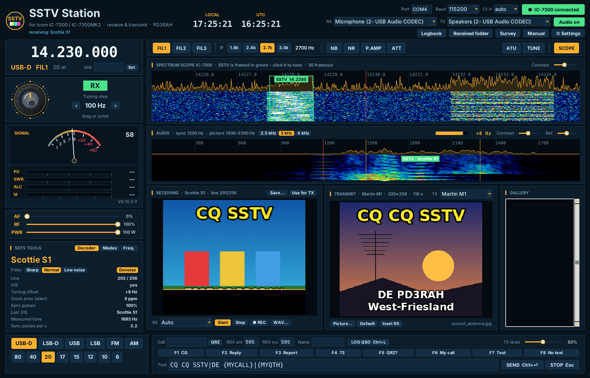

# SSTV Station for the Icom IC-7300 and IC-7300MK2

**English** · [Nederlands](#nederlands)

A free Windows program for SSTV (slow-scan television) on the Icom IC-7300 and IC-7300MK2: it receives
and transmits pictures over the radio's USB cable, and shows the radio's own spectrum scope as a
waterfall, like an SDR panadapter. Same layout as [CW Station](https://github.com/PD3RAH/cw-station).


*Screenshot with simulated signals.*

## Features

- **Receive** 15 modes: Martin M1/M2, Scottie S1/S2/DX, Robot 36/72, PD 50/90/120/160/180/240/290 and
  Wraase SC2-180.
- **Automatic mode detection** from the VIS code, with **tuning-offset correction** measured on the VIS leader.
- **Free-run start**: also starts on a series of regular sync pulses when the VIS code was missed.
- **Automatic slant correction**: a straight-line fit of the sync pulses corrects sound-card clock errors;
  the picture is rebuilt while it comes in and at the end.
- **Gallery**: every received picture is saved as PNG automatically.
- **Transmit** in all 15 modes: PTT via CI-V, audio over the USB audio CODEC (USB-D/LSB-D is selected
  automatically). No extra interface.
- **Picture composer**: load a photo (JPG/PNG/BMP/GIF/WebP/TIFF), it is cropped to the mode size; text
  templates on F1–F8 with `{MYCALL}`, `{CALL}`, `{RSV}`…; optional inset of the last received picture.
- **Panadapter**: the IC-7300's spectrum scope over CI-V. **SSTV signals are recognised and framed in green**;
  click one to tune to it exactly.
- **Radio control**: tuning knob, band buttons on the SSTV calling frequencies, mode buttons with DATA,
  FIL1–3, IF width, NB, NR, P.AMP, ATT, ATU and TUNE, AF/RF gain and TX power.
- **Meters**: S-meter, plus TX meters for power, SWR, ALC and drain current with peak hold.
- **Logbook** with ADIF export (mode SSTV, RSV report).
- **Fully automatic**: connects to the radio and starts the audio at start-up (retries until the radio is
  on), then decodes and saves every picture by itself.
- **One-click update**: downloads the small update from GitHub Releases, installs it silently and restarts.
- English and Dutch interface, 6 colour themes and a survey button.

**Manual:** [English](docs/MANUAL.md) · [Nederlands](docs/HANDLEIDING.md). The manual is also installed;
open it with the **Manual** button.

## Installation

1. Download `SSTVStation-Setup-x.y.z.exe` from [Releases](../../releases) and run it. It needs no
   admin rights, and Python is included.
2. Windows: *Settings → Privacy & security → Microphone →* turn on **"Let desktop apps access your
   microphone"**. The IC-7300 USB audio counts as a microphone.
3. On the first start, enter your callsign under **Settings**.

> The installer is not code-signed, so Windows SmartScreen shows *"Windows protected your PC"*.
> Click *More info → Run anyway*. Only download from this repository's Releases page.

Running from source instead: `pip install -r requirements.txt` and then `python src/sstv_station.py`
(Python 3.10+ with tkinter).

## Radio settings

IC-7300, MENU → SET → Connectors:

| Setting | Value |
|---|---|
| CI-V → CI-V USB Port | **Unlink from [REMOTE]** (needed for scope data) |
| CI-V → CI-V USB Baud Rate | **115200** |
| CI-V → CI-V Address | 94h (default; MK2: B6h, COM port A) |
| **DATA MOD** | **USB** (transmit audio from the USB audio in USB-D/LSB-D) |
| USB MOD Level | 50 % to start; set TX level so ALC barely moves |

USB SEND and USB Keying are not needed. The program opens the COM port with DTR and RTS low, so the
radio will not key up when it connects.

## Testing without a radio

```
pip install numpy pillow scipy
python tests/test_loopback.py          # encode -> noise / clock error / offset -> decode, all modes
```

## Building the installer

Built on Linux (or by GitHub Actions on every `v*` tag):

```
sudo apt install nsis
pip install zstandard markdown
python3 installer/build_installer.py
```

## Disclaimer

SSTV Station is provided **"as is", without any warranty**. Use is at your own risk; the author is not
liable for any damage or loss, including damage to radio, antenna or computer. You are responsible for
transmitting only where your licence permits. See the [manual, chapter 16](docs/MANUAL.md#16-disclaimer).

## License

MIT, © 2026 Richard A. Hendriksen (PD3RAH). See [LICENSE](LICENSE). The licenses of the components
bundled in the installer are listed in [THIRD_PARTY_NOTICES.md](THIRD_PARTY_NOTICES.md).

*Not affiliated with Icom Inc. "Icom", "IC-7300" and "IC-7300MK2" are trademarks of Icom Inc. and are
used only to describe compatibility.*

---

<a name="nederlands"></a>
# Nederlands

Een gratis Windows-programma voor SSTV (slow-scan televisie) met de Icom IC-7300 en IC-7300MK2. Het
ontvangt en zendt beelden via de USB-kabel van de radio en toont de eigen spectrumscope van de radio als
waterval, net als een SDR-panadapter. Zelfde opzet als [CW Station](https://github.com/PD3RAH/cw-station).

## Functies

- **Ontvangen** in 15 modi: Martin M1/M2, Scottie S1/S2/DX, Robot 36/72, PD 50/90/120/160/180/240/290 en
  Wraase SC2-180.
- **Herkent de modus automatisch** aan de VIS-code en **corrigeert de afstemfout** (gemeten op de VIS-leader).
- **Start ook zonder VIS** op een reeks regelmatige syncpulsen, als je het begin gemist hebt.
- **Automatische slant-correctie**: een rechte-lijn-fit van de syncpulsen corrigeert klokfouten van de
  geluidskaart; het beeld wordt tijdens en na de ontvangst rechtgezet.
- **Galerij**: elk ontvangen beeld wordt automatisch als PNG opgeslagen.
- **Zenden** in alle 15 modi: PTT via CI-V, audio over de USB Audio CODEC (USB-D/LSB-D wordt vanzelf
  ingesteld). Geen extra interface.
- **Beeld samenstellen**: laad een foto, die wordt bijgesneden op het modusformaat; tekstsjablonen onder
  F1–F8 met `{MYCALL}`, `{CALL}`, `{RSV}`…; optioneel het laatst ontvangen beeld als inzet.
- **Panadapter**, **radiobediening** (bandknoppen op de SSTV-frequenties, modes met DATA, filters, IF,
  NB/NR/P.AMP/ATT/ATU/TUNE), **meters** en een **logboek** met ADIF-export.
- **Volledig automatisch**: verbindt bij het opstarten met de radio en start de audio (blijft proberen tot de
  radio aan staat) en decodeert en bewaart daarna elk beeld vanzelf.
- **Bijwerken met één klik**: downloadt de kleine update van GitHub Releases, installeert die en start opnieuw.
- Nederlandse en Engelse interface, 6 kleurthema's en een enquêteknop.

**Handleiding:** [Nederlands](docs/HANDLEIDING.md) · [English](docs/MANUAL.md).

## Installatie

1. Download `SSTVStation-Setup-x.y.z.exe` bij [Releases](../../releases) en start het bestand.
2. Windows: *Instellingen → Privacy en beveiliging → Microfoon →* zet **"Desktop-apps toegang geven tot
   je microfoon"** aan.
3. Vul bij de eerste start je call in onder **Instellingen**.
4. Zet in het menu van de radio **DATA MOD** op **USB** (zie de tabel hierboven).

Windows kan *"Uw pc wordt beschermd"* melden: klik op *Meer informatie → Toch uitvoeren*.

## Disclaimer

SSTV Station wordt geleverd **"zoals het is", zonder enige garantie**. Gebruik is op eigen risico. Je
bent zelf verantwoordelijk dat je alleen uitzendt waar je machtiging dat toestaat. Zie de
[handleiding, hoofdstuk 16](docs/HANDLEIDING.md#16-disclaimer).

## Licentie

MIT, © 2026 Richard A. Hendriksen (PD3RAH). Niet gelieerd aan Icom Inc.
