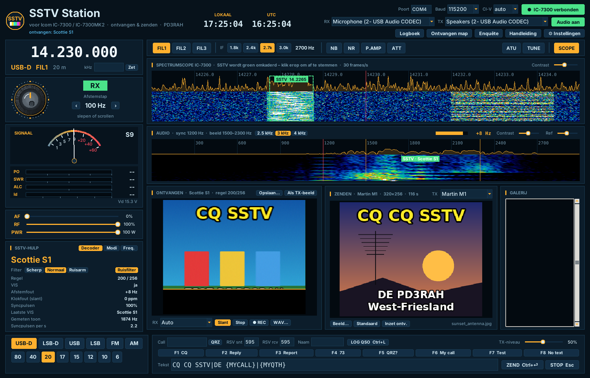

# SSTV Station – Handleiding

*Versie 1.0.0 · voor de Icom IC-7300 en IC-7300MK2 · © 2026 Richard A. Hendriksen (PD3RAH)*

SSTV Station is een gratis Windows-programma voor SSTV (slow-scan televisie) met je Icom IC-7300 of IC-7300MK2. Het programma:

- **ontvangt** SSTV-beelden uit de USB-audio van de radio, herkent de modus automatisch (VIS-code) en zet scheve beelden recht;
- **zendt** beelden via de USB-kabel: de radio gaat via CI-V op zenden, het geluid gaat over de USB-audio. Geen extra interface nodig;
- zet **tekst op je beeld** met sjablonen (CQ, antwoord, rapport, 73) en kan het ontvangen beeld als **inzet** meesturen;
- bewaart elk ontvangen beeld automatisch in een **galerij**;
- toont de **spectrumscope** van de radio als waterval, net als in CW Station;
- **bedient** de radio: frequentie, mode (met DATA-modus), filters, vermogen en tuner;
- toont een **S-meter** en digitale **zendmeters** (vermogen, SWR, ALC, stroom);
- houdt een **logboek** bij met ADIF-export.

---

## Inhoud

1. [Wat heb je nodig](#1-wat-heb-je-nodig)
2. [Installeren](#2-installeren)
3. [De radio instellen](#3-de-radio-instellen)
4. [De eerste keer starten](#4-de-eerste-keer-starten)
5. [Het scherm](#5-het-scherm)
6. [Afstemmen en banden](#6-afstemmen-en-banden)
7. [SSTV ontvangen](#7-sstv-ontvangen)
8. [SSTV zenden](#8-sstv-zenden)
9. [Meters, vermogen en tuner](#9-meters-vermogen-en-tuner)
10. [Logboek](#10-logboek)
11. [Instellingen en sjablonen](#11-instellingen-en-sjablonen)
12. [Sneltoetsen](#12-sneltoetsen)
13. [Problemen oplossen](#13-problemen-oplossen)
14. [Bestanden, bijwerken en verwijderen](#14-bestanden-bijwerken-en-verwijderen)
15. [De SSTV-modi](#15-de-sstv-modi)
16. [Disclaimer](#16-disclaimer)

---

## 1. Wat heb je nodig

- Een pc met **Windows 10 of 11**.
- Een **Icom IC-7300** of **IC-7300MK2**.
- Een **USB-kabel** tussen radio en pc: USB-B bij de IC-7300, USB-C bij de MK2.
- De **USB-driver van Icom**, te downloaden van de Icom-website. Windows 11 installeert die vaak zelf.

Python of andere software heb je niet nodig; alles zit in de installer.

## 2. Installeren

1. Download **SSTVStation-Setup-x.y.z.exe** bij *Releases* op GitHub en start het bestand.
2. Kies je taal, lees en **accepteer de disclaimer** en klik door de installatie. Beheerdersrechten zijn niet nodig.
3. Laat op het laatste scherm het vinkje **"Microfoon-privacyinstelling openen"** aan en zet daar **"Desktop-apps toegang geven tot je microfoon"** aan. Windows ziet de USB-audio van de radio als microfoon; zonder deze instelling krijgt het programma geen geluid binnen.

Er komt een snelkoppeling **SSTV Station** op je bureaublad en in het Startmenu.

### Melding "Uw pc wordt beschermd" (Windows SmartScreen)

Bij het starten van de installer toont Windows vaak een blauw scherm **"Uw pc wordt beschermd"**. Klik op **Meer informatie** en daarna op **Toch uitvoeren**.

SSTV Station is gratis hobbysoftware zonder (betaald) digitaal certificaat. Windows kent het programma daardoor niet en noemt de uitgever *"Onbekende uitgever"*. De melding betekent niet dat er een virus in zit. Download de installer alleen van de *Releases*-pagina op **github.com/PD3RAH/sstv-station**.

## 3. De radio instellen

### CI-V (bediening via USB)

**IC-7300** – MENU → SET → Connectors → CI-V:

| Instelling | Waarde |
|---|---|
| CI-V Address | 94h (standaard) |
| CI-V Transceive | ON |
| CI-V USB Port | **Unlink from [REMOTE]** (nodig voor de scope-gegevens) |
| CI-V USB Baud Rate | **115200** |
| CI-V USB Echo Back | OFF |

**IC-7300MK2** – MENU → SET → Connectors → CI-V: CI-V Address **B6h** (standaard), CI-V Transceive ON, Echo Back OFF. Kies in SSTV Station de poort die Windows **"Serial Port A (CI-V)"** noemt.

### Audio (USB) – belangrijk voor zenden

MENU → SET → Connectors:

| Instelling | Waarde | Waarom |
|---|---|---|
| **DATA MOD** | **USB** | In USB-D/LSB-D komt de modulatie van de USB-audio |
| USB MOD Level | 50 % (begin) | Samen met *TX-niveau* in het programma bepaalt dit de sturing |
| ACC/USB AF Output Level | 50 % (begin) | Ontvangstniveau naar de pc |
| SSB-D TX Bandwidth | Mid of Wide | SSTV gebruikt 1100–2300 Hz |

- **USB SEND** en **USB Keying** mogen **OFF** blijven. SSTV Station schakelt de zender via CI-V. Het programma opent de COM-poort met DTR en RTS laag, zodat de radio bij het verbinden niet gaat zenden.
- Zet de **scope** op het scherm van de radio aan (knop M.SCOPE). Alleen dan stuurt de radio scope-gegevens naar de pc.

## 4. De eerste keer starten

1. Start **SSTV Station**. Het venster **Instellingen** opent vanzelf.
2. Vul je **call**, **naam** en **QTH** in, kies **taal** en **kleur**, en klik op **Opslaan**. Zonder call kun je niet zenden.
3. Kies rechtsboven de **Poort**, bijvoorbeeld COM4. Laat **Baud** op 115200 en **CI-V** op **auto** staan.
4. Klik op **● Verbind radio**. Wordt de knop groen met *"IC-7300 verbonden"*, dan is de verbinding gelukt.
5. Kies bij **RX** het apparaat **Microfoon (USB Audio CODEC)** en bij **TX** **Luidsprekers (USB Audio CODEC)**. Het programma kiest ze meestal al zelf.
6. Klik op **Start audio**.

Het programma onthoudt deze keuzes. **Vanaf de volgende keer gaat alles vanzelf:** bij het opstarten verbindt SSTV Station met de radio en start het de audio, en daarna decodeert het elk beeld automatisch. Staat de radio nog uit, dan probeert het programma het elke 10 seconden opnieuw; zet je de radio aan, dan verbindt het vanzelf. Wat je zelf uitzet (Verbind radio of Audio), blijft uit tot je het weer aanzet. Automatisch starten kun je uitzetten bij Instellingen.

## 5. Het scherm

| Deel | Wat het doet |
|---|---|
| **Kopbalk** | Poort, baud, CI-V-adres, verbindknop, RX- en TX-audio, Logboek, Ontvangen map, Enquête, Handleiding, Instellingen, klok (lokaal en UTC) en een statusregel |
| **Frequentie** | Frequentie, mode (bijv. *USB-D FIL1*) en band. Typ een frequentie in kHz en druk Enter. Een mode in oranje betekent: DATA staat uit |
| **Afstemknop** | Slepen of scrollen; stapgrootte met ‹ en ›. Het RX/TX-blok wordt rood tijdens zenden |
| **S-meter en zendmeters** | Signaalsterkte; tijdens zenden vermogen, SWR, ALC en stroom met piekwaarde |
| **AF / RF / PWR** | Volume, RF-versterking en zendvermogen van de radio |
| **SSTV-hulp** | *Decoder*: status, regel, VIS, afstemfout, klokfout, syncpulsen. *Modi*: alle modi met VIS-code, formaat en duur. *Freq.*: SSTV-frequenties (dubbelklik om af te stemmen) |
| **Bovenbalk rechts** | FIL1–3, IF-breedte (1,8 / 2,4 / 2,7 / 3,0 kHz), NB, NR, P.AMP, ATT, ATU, TUNE en SCOPE |
| **Spectrumscope** | De scope van de radio als waterval. Klik op een signaal om erop af te stemmen |
| **Audio** | Waterval van de audio met lijnen op 1200 Hz (sync, rood), 1500 Hz (zwart) en 2300 Hz (wit). Rechts het niveau en de gemeten afstemfout |
| **Ontvangen** | Het beeld dat binnenkomt, met een lijn op de huidige regel. Daaronder: RX-modus, Slant, Stop, ● REC, WAV…, Opslaan… en Als TX-beeld |
| **Zenden** | Voorbeeld van het zendbeeld, TX-modus en duur. Daaronder: Beeld…, Standaard en Inzet ontv. |
| **Galerij** | Alle ontvangen beelden, nieuwste boven. Klik = tonen, dubbelklik = openen |
| **Onderbalk** | Modeknoppen (USB-D, LSB-D, USB, LSB, FM, AM), banden, QSO-gegevens, TX-niveau, sjablonen F1–F8, tekstregel, ZEND en STOP |

## 6. Afstemmen en banden

De bandknoppen springen naar de gebruikelijke SSTV-frequentie en zetten de radio meteen in **LSB-D** (80 en 40 m) of **USB-D** (20 m en hoger):

| Band | Frequentie | Zijband |
|---|---|---|
| 80 m | 3.735 MHz | LSB |
| 40 m | 7.165 MHz | LSB |
| 20 m | 14.230 MHz | USB |
| 17 m | 18.160 MHz | USB |
| 15 m | 21.340 MHz | USB |
| 12 m | 24.975 MHz | USB |
| 10 m | 28.680 MHz | USB |
| 6 m | 50.510 MHz | USB |

Op 20 m wordt ook 14.233 MHz veel gebruikt; op 40 m ook 7.171 MHz. **SSTV-signalen worden in de spectrumscope automatisch herkend** en groen omkaderd, met de afstemfrequentie erbij (bijv. *SSTV 14.2265*). Het programma herkent SSTV aan een band van ongeveer 1,1 kHz breed die onafgebroken aan staat; spraak, CW en smalle digitale signalen worden niet gemarkeerd. Herkenning duurt een paar seconden en werkt het best met een scope-span van ±2,5 tot ±25 kHz. **Klik in het groene kader** en de radio staat er precies op. Tijdens het decoderen staat in de audiowaterval een groen label met de modus.

Stem met de knop, of klik in de spectrumscope midden op een signaal: het programma stemt de radio dan zo af dat het signaal in de audio tussen 1200 en 2300 Hz valt (in USB komt de radiofrequentie 1,75 kHz onder je klik, in LSB 1,75 kHz erboven).

Kies je een band met de bandknop, dan zet het programma ook het IF-filter op 2,7 kHz als het smaller is. De IC-7300 staat in USB-D/LSB-D namelijk standaard op een smal filter (FIL1 1,2 kHz).

**Afstemmen hoeft niet op de hertz.** Bij een beeld met VIS-code meet het programma de afstemfout (zichtbaar bij *Afstemfout* en rechts boven de audiowaterval) en corrigeert die. Een afwijking tot ongeveer 60 Hz is geen probleem. Een grotere afwijking geeft kleurfouten: stem dan bij.

Gebruik voor SSTV een filter van **2,4 kHz of breder** (de knoppen 2.4k, 2.7k of 3.0k).

## 7. SSTV ontvangen

1. Kies een band, zorg dat **Audio aan** groen is en wacht. In de audiowaterval zie je een SSTV-signaal als een band tussen 1200 en 2300 Hz.
2. Begint een uitzending, dan herkent het programma de **VIS-code** (de korte toonreeks aan het begin) en kiest het de juiste modus. Het beeld bouwt zich regel voor regel op.
3. Aan het eind wordt het beeld automatisch als PNG **opgeslagen** en in de **galerij** gezet.

### RX-modus

- **Auto** (standaard): de modus komt uit de VIS-code. Mis je het begin, dan start het programma toch zodra het een reeks regelmatige syncpulsen herkent (*vrijloop*, te zien als *VIS: nee*). Het beeld begint dan op de regel waar je inviel.
- **Een vaste modus**: het programma decodeert alles in die modus. Handig als een station een ongebruikelijke of verkeerde VIS-code stuurt.

Vrijloop kun je uitzetten bij Instellingen (*Ook starten zonder VIS*).

### Slant (scheefstand)

Als de klok van de zender en die van jouw geluidskaart een fractie verschillen, wordt een SSTV-beeld scheef. Met **Slant** aan meet het programma de syncpulsen en zet het beeld recht, ook achteraf: elke 16 regels en aan het eind wordt het hele beeld opnieuw opgebouwd. De gemeten afwijking staat bij *Klokfout (slant)* in ppm. Laat Slant normaal aan.

### Filter en ruisfilter

Bovenin **SSTV-hulp → Decoder** kies je het ontvangstfilter:

| Filter | Wanneer |
|---|---|
| **Scherp** | Sterke, schone signalen: de meeste details |
| **Normaal** (standaard) | Voor de meeste signalen op HF |
| **Ruisarm** | Zwakke signalen: minder ruis, iets zachter beeld |

Bij veel ruis meet de decoder via de syncpulsen hoe ver de ruis het beeld 'samendrukt' (donkerder en grijzer maakt) en rekent dat terug, en randpixels meten niet meer in de syncpuls (geen gekleurde rand). **Ruisfilter** (standaard aan) haalt na afloop losse ruispixels weg zonder randen en tekst te vervagen. Bij kleine modi (320 breed) gebeurt dat ook tijdens de ontvangst. De decoder middelt de frequentie per pixel gewogen naar de signaalsterkte, zodat ruispieken nauwelijks meetellen, en herkent de VIS-code ook bij zwakke signalen.

### Wordt er niets gedecodeerd?

Kijk in **SSTV-hulp → Decoder**. Onderaan staat een waarschuwing als er iets niet klopt (geen audio, verkeerd audioapparaat, verkeerde zijband, te smal filter).

- **Gemeten toon** moet tijdens een SSTV-uitzending tussen ongeveer 1200 en 2300 Hz liggen. Zie je het signaal in de *spectrumscope* maar niet in de *audiowaterval*, dan staat de radio er niet goed op afgestemd: klik midden op het signaal in de scope.
- **Syncpulsen per s** loopt tijdens een beeld op (Martin/Scottie ongeveer 2,2 per seconde, Robot 36 bijna 7).
- **● REC** neemt de audio van de radio op als WAV (maximaal 10 minuten; in `%APPDATA%\SSTVStation\recordings`). Met **WAV…** decodeer je zo'n opname later opnieuw, of een WAV-bestand van internet. Stuur een opname mee als je een probleem meldt.

### Stoppen en opslaan

- **Stop** breekt de ontvangst af. Heeft het beeld minstens een kwart van de regels, dan wordt het (deel)beeld bewaard.
- Valt het signaal weg, dan stopt de ontvangst vanzelf na een paar seconden zonder syncpulsen.
- **Opslaan…** bewaart het getoonde beeld ergens anders (PNG of JPEG).
- **Als TX-beeld** gebruikt het ontvangen beeld als achtergrond voor je eigen uitzending.

Tijdens het zenden staat de ontvangst stil. Een lopende ontvangst wordt dan afgesloten en, als hij lang genoeg was, bewaard.

## 8. SSTV zenden

### Het zendbeeld

1. Klik in het blok **Zenden** op **Beeld…** en kies een foto (JPG, PNG, BMP, GIF, WebP of TIFF). Het programma snijdt de foto bij tot het formaat van de modus (bijv. 320×256), zonder vervorming. **Standaard** zet een rustige achtergrond terug.
2. Kies rechts boven het voorbeeld de **TX-modus**. De duur van de uitzending staat in de titel. *Martin M1* en *Scottie S1* zijn in Europa en de VS het meest gebruikt; *PD 120* en *PD 180* geven een hogere resolutie.
3. Zet tekst op het beeld met een **sjabloon** (F1–F8) of typ zelf in de regel **Tekst**:
   - een **|** maakt een nieuwe regel;
   - de **eerste regel** komt groot en geel bovenaan, de **overige regels** wit onderaan;
   - **{MYCALL}**, **{CALL}**, **{RSV}**, **{NAME}**, **{MYNAME}** en **{MYQTH}** worden ingevuld met je eigen gegevens en de velden in de onderbalk.

   Voorbeeld: `CQ CQ SSTV|DE {MYCALL}|{MYQTH}`
4. **Inzet ontv.** zet het laatst ontvangen beeld klein rechts in je zendbeeld: gebruikelijk als antwoord ("ik heb je beeld goed ontvangen").

Het voorbeeld wordt direct bijgewerkt. Wat je ziet, is precies wat je uitzendt.

### Zenden

1. Controleer frequentie, vermogen en of de frequentie vrij is.
2. Klik op **ZEND** of druk **Ctrl+Enter**. Het programma:
   - zet de radio in **USB-D** of **LSB-D** als dat nog niet zo is;
   - controleert of je eigen call in de tekst staat (zo niet, dan vraagt het of je toch wilt zenden);
   - schakelt de zender in via CI-V, zendt kalibratietonen, de VIS-code en het beeld, en schakelt de zender weer uit.
3. Een rode lijn in het voorbeeld laat zien hoe ver de uitzending is; rechtsonder staat de resterende tijd.
4. **STOP** of **Esc** breekt de uitzending direct af en zet de radio terug op ontvangen.

### Sturing: TX-niveau en ALC

SSTV is een frequentiegemoduleerd signaal met constante amplitude. Een te hoge sturing geeft geen hoger vermogen, wel splatter.

Met **Auto-ALC** (onderbalk, standaard aan) regelt het programma dit zelf: slaat de ALC tijdens het zenden te ver uit, dan wordt het TX-niveau in stapjes verlaagd tot de ALC weer in het groene gebied zit. Het gevonden niveau wordt onthouden voor de volgende uitzending.

Handmatig gaat het zo (Auto-ALC uit, of om de beginstand te kiezen):

1. Zet **PWR** op het gewenste vermogen.
2. Zend een beeld en kijk naar de **ALC**-meter. Stel **TX-niveau** (onderbalk) zo in dat de ALC net niet of nauwelijks uitslaat, terwijl het vermogen vrijwel het ingestelde maximum haalt. De schuif werkt direct, ook midden in een uitzending.
3. Komt het vermogen niet hoog genoeg, verhoog dan *USB MOD Level* in het menu van de radio.
4. Blijft de ALC zelfs op een laag TX-niveau uitslaan, verlaag dan *USB MOD Level* in het menu van de radio (bijv. naar 30 %).

> **Inschakelduur.** SSTV zendt de hele tijd met vol vermogen (100 % inschakelduur), bij PD 290 bijna vijf minuten achter elkaar. Gebruik bij lange modi liever **30–50 W** en zorg voor koeling van de eindtrap.

> **Identificatie.** Je call moet in de uitzending staan. De sjablonen zetten {MYCALL} er automatisch in.

## 9. Meters, vermogen en tuner

- **S-meter**: signaalsterkte bij ontvangst.
- **PO, SWR, ALC, Id**: alleen tijdens zenden, met piekwaarde. De waarden zijn een benadering op basis van de CI-V-schaal van Icom, geen meetinstrument. Onder de meters staat de voedingsspanning (Vd).
- **PWR**-schuif: zendvermogen van de radio.
- **ATU** zet de ingebouwde tuner aan of uit; **TUNE** start het afstemmen (de radio zendt dan kort een draaggolf).

## 10. Logboek

Vul **Call**, **RSV snt**, **RSV rcv** en eventueel **Naam** in en klik op **LOG QSO** of druk **Ctrl+L**. De verbinding wordt opgeslagen met datum, tijd (UTC), band, frequentie en mode **SSTV**; in het commentaar staat de SSTV-modus. Bij SSTV is het rapport een **RSV**-rapport (leesbaarheid, sterkte, video; 595 is het beste).

Via **Logboek** in de kopbalk zie je alle verbindingen. **Exporteer ADIF…** maakt een kopie voor je logprogramma of LoTW.

## 11. Instellingen en sjablonen

Via **⚙ Instellingen**:

- **Taal** en **kleur** (zes thema's). De kleur verandert direct.
- **Mijn call**, **naam** en **QTH** voor de sjablonen.
- **Updates**: automatisch kijken of er een nieuwe versie is.
- **Kalibratietonen vóór VIS**: de korte toonreeks die MMSSTV ook zendt; helpt het tegenstation bij het afstemmen.
- **Ook starten zonder VIS**: vrijloop aan of uit (zie hoofdstuk 7).
- **Radio en audio automatisch starten**: verbinden en audio starten bij het opstarten (zie hoofdstuk 4). Standaard aan.
- **Beeldtekst-sjablonen** F1–F8: een korte naam voor de knop en de tekst met | en {…}-velden.

## 12. Sneltoetsen

| Toets | Functie |
|---|---|
| F1 – F8 | Sjabloon kiezen (tekst op het beeld) |
| Enter (in tekstregel) | Zendbeeld bijwerken |
| Ctrl+Enter | Beeld zenden |
| Esc | Zenden stoppen |
| Ctrl+L | QSO loggen |
| Scrollwiel op frequentie | Afstemmen |

## 13. Problemen oplossen

| Probleem | Oplossing |
|---|---|
| Geen verbinding met de radio | Controleer COM-poort (Apparaatbeheer), baud 115200 en CI-V-adres. Sluit andere programma's die dezelfde poort gebruiken |
| Geen scope | Zet *CI-V USB Port* op **Unlink from [REMOTE]** en de scope op de radio aan |
| Statusregel: *geen geluid ontvangen* | Klik op de melding en zet *Desktop-apps toegang geven tot je microfoon* aan. Kies bij RX het USB Audio CODEC |
| Bij **TX** staat *Realtek* of een ander apparaat | Kies **Luidsprekers (USB Audio CODEC)**, anders gaat het zendgeluid naar de luidsprekers van de pc en zendt de radio een lege draaggolf. Doe hetzelfde bij **RX** (Microfoon, USB Audio CODEC) |
| Beeld wordt niet gestart | Staat de RX-modus op *Auto*? Is het signaal sterk genoeg (zichtbaar tussen 1200 en 2300 Hz)? Probeer een vaste modus |
| Beeld is scheef | Laat **Slant** aan. Een beeld zonder VIS dat halverwege begint, wordt pas recht als er genoeg regels binnen zijn |
| Kleuren kloppen niet | Afstemfout te groot: stem bij. Of het tegenstation zendt een andere modus dan de VIS-code zegt: kies de modus met de hand |
| Zenden: geen vermogen | Staat **DATA MOD** op **USB** in het menu? Staat de radio in USB-D/LSB-D? Is het TX-audioapparaat het USB Audio CODEC? Verhoog TX-niveau of USB MOD Level |
| Zenden: ALC slaat ver uit | Zet **Auto-ALC** aan (onderbalk), of verlaag TX-niveau of USB MOD Level |
| *Zenden mislukt* | Het TX-audioapparaat is bezet of verwijderd. Kies het opnieuw. Details staan in `error.log` |

Fouten worden vastgelegd in `%APPDATA%\SSTVStation\error.log`. Stuur dat bestand mee als je een probleem meldt.

## 14. Bestanden, bijwerken en verwijderen

| Wat | Waar |
|---|---|
| Programma | `%LOCALAPPDATA%\SSTVStation` |
| Instellingen | `%APPDATA%\SSTVStation\settings.json` |
| Logboek | `%APPDATA%\SSTVStation\logbook.adi` |
| Ontvangen beelden | `%APPDATA%\SSTVStation\received\` (knop **Ontvangen map**) |
| Foutlog | `%APPDATA%\SSTVStation\error.log` |

### Bijwerken

Bij het starten kijkt SSTV Station op GitHub of er een nieuwe versie is (uit te zetten bij Instellingen → *Automatisch controleren*). Is die er, dan verschijnt de knop **⬆ Nieuwe versie** in de kopbalk en krijg je één keer de vraag:

- **Ja** – nu bijwerken. Het programma downloadt de kleine update (ongeveer 1 MB), sluit af, installeert die en start daarna vanzelf opnieuw. Dit duurt een paar seconden.
- **Nee** – de releasepagina openen om te lezen wat er nieuw is.
- **Annuleren** – later. De knop **⬆ Nieuwe versie** blijft staan.

Tijdens het zenden kan er niet bijgewerkt worden. Wordt er net een beeld ontvangen, dan vraagt het programma eerst of het toch mag; het deelbeeld wordt bewaard. Lukt de download niet, dan opent de releasepagina, zodat je de installer zelf kunt downloaden. Je kunt een nieuwe versie ook altijd met de volledige installer over de oude heen installeren. Instellingen, logboek en beelden blijven altijd bewaard. 

### Verwijderen

Verwijderen kan via *Windows-instellingen → Apps*. Ook dan blijven je instellingen, logboek en beelden staan.

## 15. De SSTV-modi

| Modus | VIS | Formaat | Duur | Kleur |
|---|---|---|---|---|
| Martin M1 | 44 | 320×256 | 114 s | RGB |
| Martin M2 | 40 | 320×256 | 58 s | RGB |
| Scottie S1 | 60 | 320×256 | 110 s | RGB |
| Scottie S2 | 56 | 320×256 | 71 s | RGB |
| Scottie DX | 76 | 320×256 | 269 s | RGB |
| Robot 36 | 8 | 320×240 | 36 s | YUV |
| Robot 72 | 12 | 320×240 | 72 s | YUV |
| PD 50 | 93 | 320×256 | 50 s | YUV |
| PD 90 | 99 | 320×256 | 90 s | YUV |
| PD 120 | 95 | 640×496 | 126 s | YUV |
| PD 160 | 98 | 512×400 | 161 s | YUV |
| PD 180 | 96 | 640×496 | 187 s | YUV |
| PD 240 | 97 | 640×496 | 248 s | YUV |
| PD 290 | 94 | 800×616 | 289 s | YUV |
| Wraase SC2-180 | 55 | 320×256 | 182 s | RGB |

De duur is zonder VIS en kalibratietonen (samen ongeveer 1,7 s extra). Alle modi worden ontvangen én gezonden.

## 16. Disclaimer

SSTV Station is gratis software en wordt geleverd **"zoals het is"**, zonder enige garantie.

- Gebruik is op eigen risico. De maker is niet aansprakelijk voor schade of verlies door het gebruik van dit programma, zoals schade aan radio, antenne of computer, verlies van gegevens of storing.
- Jij bent verantwoordelijk voor wat je uitzendt. Zend alleen op frequenties, banden en met vermogens die je machtiging toestaat.
- Aan dit programma en deze handleiding kunnen geen rechten worden ontleend. Meterwaarden zijn een benadering.
- Niet gelieerd aan Icom Inc. "Icom", "IC-7300" en "IC-7300MK2" zijn merknamen van Icom Inc.
