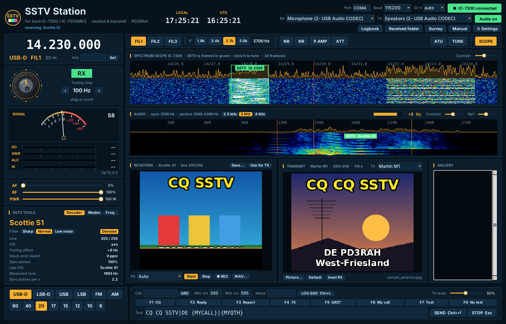

# SSTV Station – Manual

*Version 1.0.0 · for the Icom IC-7300 and IC-7300MK2 · © 2026 Richard A. Hendriksen (PD3RAH)*

SSTV Station is a free Windows program for SSTV (slow-scan television) with your Icom IC-7300 or IC-7300MK2. The program:

- **receives** SSTV pictures from the radio's USB audio, detects the mode automatically (VIS code) and straightens slanted pictures;
- **transmits** pictures over the USB cable: the radio is keyed via CI-V and the audio goes over the USB audio. No extra interface is needed;
- puts **text on your picture** with templates (CQ, reply, report, 73) and can include the received picture as an **inset**;
- saves every received picture automatically in a **gallery**;
- shows the radio's **spectrum scope** as a waterfall, just like CW Station;
- **controls** the radio: frequency, mode (with DATA mode), filters, power and tuner;
- shows an **S-meter** and digital **TX meters** (power, SWR, ALC, current);
- keeps a **logbook** with ADIF export.

---

## Contents

1. [What you need](#1-what-you-need)
2. [Installation](#2-installation)
3. [Setting up the radio](#3-setting-up-the-radio)
4. [First start](#4-first-start)
5. [The screen](#5-the-screen)
6. [Tuning and bands](#6-tuning-and-bands)
7. [Receiving SSTV](#7-receiving-sstv)
8. [Transmitting SSTV](#8-transmitting-sstv)
9. [Meters, power and tuner](#9-meters-power-and-tuner)
10. [Logbook](#10-logbook)
11. [Settings and templates](#11-settings-and-templates)
12. [Keyboard shortcuts](#12-keyboard-shortcuts)
13. [Troubleshooting](#13-troubleshooting)
14. [Files, updating and uninstalling](#14-files-updating-and-uninstalling)
15. [The SSTV modes](#15-the-sstv-modes)
16. [Disclaimer](#16-disclaimer)

---

## 1. What you need

- A PC with **Windows 10 or 11**.
- An **Icom IC-7300** or **IC-7300MK2**.
- A **USB cable** between radio and PC: USB-B on the IC-7300, USB-C on the MK2.
- The **Icom USB driver**, available from the Icom website. Windows 11 often installs it by itself.

You do not need Python or other software; everything is included in the installer.

## 2. Installation

1. Download **SSTVStation-Setup-x.y.z.exe** from *Releases* on GitHub and run it.
2. Choose your language, read and **accept the disclaimer** and click through the installation. No admin rights are needed.
3. On the last page, leave **"Open microphone privacy settings"** ticked and turn on **"Let desktop apps access your microphone"**. Windows treats the radio's USB audio as a microphone; without this setting the program receives no sound.

A **SSTV Station** shortcut is placed on your desktop and in the Start menu.

### "Windows protected your PC" (Windows SmartScreen)

When you start the installer, Windows often shows a blue **"Windows protected your PC"** screen. Click **More info** and then **Run anyway**.

SSTV Station is free hobby software without a (paid) code-signing certificate, so Windows does not know the program and lists the publisher as *"Unknown publisher"*. The message does not mean there is a virus. Only download the installer from the *Releases* page at **github.com/PD3RAH/sstv-station**.

## 3. Setting up the radio

### CI-V (control over USB)

**IC-7300** – MENU → SET → Connectors → CI-V:

| Setting | Value |
|---|---|
| CI-V Address | 94h (default) |
| CI-V Transceive | ON |
| CI-V USB Port | **Unlink from [REMOTE]** (needed for scope data) |
| CI-V USB Baud Rate | **115200** |
| CI-V USB Echo Back | OFF |

**IC-7300MK2** – MENU → SET → Connectors → CI-V: CI-V Address **B6h** (default), CI-V Transceive ON, Echo Back OFF. In SSTV Station, select the port Windows calls **"Serial Port A (CI-V)"**.

### Audio (USB) – important for transmitting

MENU → SET → Connectors:

| Setting | Value | Why |
|---|---|---|
| **DATA MOD** | **USB** | In USB-D/LSB-D the modulation comes from the USB audio |
| USB MOD Level | 50 % (start) | Together with *TX level* in the program this sets the drive |
| ACC/USB AF Output Level | 50 % (start) | Receive level to the PC |
| SSB-D TX Bandwidth | Mid or Wide | SSTV uses 1100–2300 Hz |

- **USB SEND** and **USB Keying** can stay **OFF**. SSTV Station keys the transmitter via CI-V. The program opens the COM port with DTR and RTS low, so the radio does not key up when it connects.
- Turn the **scope** on at the radio (M.SCOPE button). Only then does the radio send scope data to the PC.

## 4. First start

1. Start **SSTV Station**. The **Settings** window opens automatically.
2. Enter your **call**, **name** and **QTH**, choose **language** and **colour**, and click **Save**. You cannot transmit without a callsign.
3. At the top right, choose the **Port**, for example COM4. Leave **Baud** at 115200 and **CI-V** at **auto**.
4. Click **● Connect radio**. When the button turns green with *"IC-7300 connected"*, the connection works.
5. For **RX** choose **Microphone (USB Audio CODEC)** and for **TX** **Speakers (USB Audio CODEC)**. The program usually selects them by itself.
6. Click **Start audio**.

The program remembers these choices. **From the next start on, everything is automatic:** SSTV Station connects to the radio and starts the audio when it opens, and then decodes every picture by itself. If the radio is still off, the program retries every 10 seconds and connects as soon as you switch the radio on. Whatever you switch off yourself (Connect radio or Audio) stays off until you switch it on again. Automatic start can be turned off in Settings.

## 5. The screen

| Part | What it does |
|---|---|
| **Header** | Port, baud, CI-V address, connect button, RX and TX audio, Logbook, Received folder, Survey, Manual, Settings, clock (local and UTC) and a status line |
| **Frequency** | Frequency, mode (e.g. *USB-D FIL1*) and band. Type a frequency in kHz and press Enter. A mode shown in orange means DATA is off |
| **Tuning knob** | Drag or scroll; step size with ‹ and ›. The RX/TX block turns red while transmitting |
| **S-meter and TX meters** | Signal strength; while transmitting power, SWR, ALC and current with peak hold |
| **AF / RF / PWR** | Volume, RF gain and output power of the radio |
| **SSTV tools** | *Decoder*: status, line, VIS, tuning offset, clock error, sync pulses. *Modes*: all modes with VIS code, size and duration. *Freq.*: SSTV frequencies (double-click to tune) |
| **Top bar right** | FIL1–3, IF width (1.8 / 2.4 / 2.7 / 3.0 kHz), NB, NR, P.AMP, ATT, ATU, TUNE and SCOPE |
| **Spectrum scope** | The radio's scope as a waterfall. Click a signal to tune to it |
| **Audio** | Audio waterfall with lines at 1200 Hz (sync, red), 1500 Hz (black) and 2300 Hz (white). On the right the level and the measured tuning offset |
| **Receiving** | The incoming picture, with a line at the current line. Below: RX mode, Slant, Stop, ● REC, WAV…, Save… and Use for TX |
| **Transmit** | Preview of the picture to send, TX mode and duration. Below: Picture…, Default and Inset RX |
| **Gallery** | All received pictures, newest on top. Click = show, double-click = open |
| **Bottom bar** | Mode buttons (USB-D, LSB-D, USB, LSB, FM, AM), bands, QSO fields, TX level, templates F1–F8, text line, SEND and STOP |

## 6. Tuning and bands

The band buttons jump to the usual SSTV frequency and immediately set the radio to **LSB-D** (80 and 40 m) or **USB-D** (20 m and up):

| Band | Frequency | Sideband |
|---|---|---|
| 80 m | 3.735 MHz | LSB |
| 40 m | 7.165 MHz | LSB |
| 20 m | 14.230 MHz | USB |
| 17 m | 18.160 MHz | USB |
| 15 m | 21.340 MHz | USB |
| 12 m | 24.975 MHz | USB |
| 10 m | 28.680 MHz | USB |
| 6 m | 50.510 MHz | USB |

On 20 m, 14.233 MHz is also popular; on 40 m also 7.171 MHz. **SSTV signals are recognised in the spectrum scope automatically** and framed in green, with the tuning frequency (e.g. *SSTV 14.2265*). The program recognises SSTV as a band of about 1.1 kHz that is on without pauses; voice, CW and narrow digital signals are not marked. Recognition takes a few seconds and works best with a scope span of ±2.5 to ±25 kHz. **Click inside the green frame** and the radio is tuned exactly to it. While decoding, a green label with the mode appears in the audio waterfall.

Tune with the knob, or click the middle of a signal in the spectrum scope: the program then tunes the radio so that the signal falls between 1200 and 2300 Hz in the audio (in USB the dial goes 1.75 kHz below your click, in LSB 1.75 kHz above).

When you choose a band with a band button, the program also sets the IF filter to 2.7 kHz if it is narrower. In USB-D/LSB-D the IC-7300 uses a narrow filter by default (FIL1 1.2 kHz).

**You do not have to tune to the hertz.** For a picture with a VIS code, the program measures the tuning offset (shown at *Tuning offset* and above the audio waterfall) and corrects it. An offset of up to about 60 Hz is no problem. A larger offset gives colour errors: retune.

For SSTV, use a filter of **2.4 kHz or wider** (buttons 2.4k, 2.7k or 3.0k).

## 7. Receiving SSTV

1. Choose a band, make sure **Audio on** is green and wait. In the audio waterfall an SSTV signal shows as a band between 1200 and 2300 Hz.
2. When a transmission starts, the program recognises the **VIS code** (the short tone sequence at the start) and selects the right mode. The picture builds up line by line.
3. At the end, the picture is **saved** automatically as PNG and added to the **gallery**.

### RX mode

- **Auto** (default): the mode comes from the VIS code. If you miss the start, the program still starts as soon as it recognises a series of regular sync pulses (*free-run*, shown as *VIS: no*). The picture then starts at the line where you tuned in.
- **A fixed mode**: everything is decoded in that mode. Useful when a station sends an unusual or wrong VIS code.

Free-run can be turned off in Settings (*Also start without VIS*).

### Slant

When the transmitter's clock and your sound card's clock differ slightly, an SSTV picture becomes slanted. With **Slant** on, the program measures the sync pulses and straightens the picture, also afterwards: every 16 lines and at the end the whole picture is rebuilt. The measured difference is shown at *Clock error (slant)* in ppm. Normally leave Slant on.

### Filter and denoise

At the top of **SSTV tools → Decoder** you choose the receive filter:

| Filter | When |
|---|---|
| **Sharp** | Strong, clean signals: most detail |
| **Normal** (default) | Most HF signals |
| **Low noise** | Weak signals: less noise, slightly softer picture |

**Denoise** (on by default) removes single noise pixels after reception without blurring edges and text. For small modes (320 wide) this is also done while receiving. The decoder averages the frequency per pixel weighted by signal strength, so noise spikes hardly count, and recognises the VIS code on weak signals too.

### Nothing is decoded?

Look at **SSTV tools → Decoder**. A warning at the bottom tells you if something is wrong (no audio, wrong audio device, wrong sideband, filter too narrow).

- **Measured tone** must be between about 1200 and 2300 Hz during an SSTV transmission. If you see the signal in the *spectrum scope* but not in the *audio waterfall*, the radio is not tuned to it: click the middle of the signal in the scope.
- **Sync pulses per s** goes up during a picture (Martin/Scottie about 2.2 per second, Robot 36 almost 7).
- **● REC** records the radio's audio as WAV (up to 10 minutes; in `%APPDATA%\SSTVStation\recordings`). With **WAV…** you decode such a recording again later, or a WAV file from the internet. Please include a recording when you report a problem.

### Stopping and saving

- **Stop** ends the reception. If the picture has at least a quarter of its lines, the (partial) picture is saved.
- If the signal disappears, reception stops by itself after a few seconds without sync pulses.
- **Save…** saves the shown picture somewhere else (PNG or JPEG).
- **Use for TX** uses the received picture as background for your own transmission.

Reception pauses while you transmit. A reception in progress is then finished and saved if it was long enough.

## 8. Transmitting SSTV

### The picture

1. In the **Transmit** block, click **Picture…** and choose a photo (JPG, PNG, BMP, GIF, WebP or TIFF). The program crops the photo to the size of the mode (e.g. 320×256) without distortion. **Default** restores a plain background.
2. Choose the **TX mode** above the preview. The duration of the transmission is shown in the title. *Martin M1* and *Scottie S1* are the most used modes in Europe and the US; *PD 120* and *PD 180* give a higher resolution.
3. Put text on the picture with a **template** (F1–F8) or type in the **Text** line:
   - a **|** starts a new line;
   - the **first line** appears large and yellow at the top, the **other lines** white at the bottom;
   - **{MYCALL}**, **{CALL}**, **{RSV}**, **{NAME}**, **{MYNAME}** and **{MYQTH}** are filled in from your settings and the fields in the bottom bar.

   Example: `CQ CQ SSTV|DE {MYCALL}|{MYQTH}`
4. **Inset RX** places the last received picture small on the right of your picture: customary in a reply ("I received your picture").

The preview updates immediately. What you see is exactly what you send.

### Transmitting

1. Check frequency and power, and that the frequency is free.
2. Click **SEND** or press **Ctrl+Enter**. The program:
   - sets the radio to **USB-D** or **LSB-D** if needed;
   - checks that your own call is in the text (if not, it asks whether to transmit anyway);
   - keys the transmitter via CI-V, sends calibration tones, the VIS code and the picture, and unkeys again.
3. A red line in the preview shows the progress; the remaining time is shown at the bottom right.
4. **STOP** or **Esc** aborts the transmission at once and returns the radio to receive.

### Drive: TX level and ALC

SSTV is a frequency-modulated signal with constant amplitude. Overdriving does not give more power, only splatter.

With **Auto-ALC** (bottom bar, on by default) the program handles this itself: if ALC goes too high while transmitting, the TX level is lowered step by step until ALC is back in the green zone. The level found is remembered for the next transmission.

Manually (Auto-ALC off, or to choose the starting level):

1. Set **PWR** to the desired power.
2. Send a picture and watch the **ALC** meter. Set **TX level** (bottom bar) so that ALC barely moves while the power almost reaches the set maximum. The slider works immediately, also in the middle of a transmission.
3. If the power stays too low, raise *USB MOD Level* in the radio's menu.
4. If ALC stays high even at a low TX level, lower *USB MOD Level* in the radio's menu (e.g. to 30 %).

> **Duty cycle.** SSTV transmits at full power all the time (100 % duty cycle), with PD 290 for almost five minutes. For long modes prefer **30–50 W** and make sure the final amplifier is cooled.

> **Identification.** Your callsign must be in the transmission. The templates add {MYCALL} automatically.

## 9. Meters, power and tuner

- **S-meter**: signal strength while receiving.
- **PO, SWR, ALC, Id**: only while transmitting, with peak hold. The values are approximations based on Icom's CI-V scale, not a measuring instrument. The supply voltage (Vd) is shown below the meters.
- **PWR** slider: output power of the radio.
- **ATU** switches the internal tuner on or off; **TUNE** starts tuning (the radio briefly transmits a carrier).

## 10. Logbook

Fill in **Call**, **RSV snt**, **RSV rcv** and optionally **Name**, then click **LOG QSO** or press **Ctrl+L**. The contact is saved with date, time (UTC), band, frequency and mode **SSTV**; the comment holds the SSTV mode. SSTV uses an **RSV** report (readability, strength, video; 595 is best).

**Logbook** in the header shows all contacts. **Export ADIF…** makes a copy for your logging program or LoTW.

## 11. Settings and templates

Via **⚙ Settings**:

- **Language** and **colour** (six themes). The colour changes immediately.
- **My call**, **name** and **QTH** for the templates.
- **Updates**: check automatically for a new version.
- **Calibration tones before VIS**: the short tone sequence MMSSTV also sends; it helps the other station tune.
- **Also start without VIS**: free-run on or off (see chapter 7).
- **Connect radio and start audio automatically**: connect and start audio at start-up (see chapter 4). On by default.
- **Picture text templates** F1–F8: a short name for the button and the text with | and {…} fields.

## 12. Keyboard shortcuts

| Key | Function |
|---|---|
| F1 – F8 | Choose template (text on the picture) |
| Enter (in text line) | Update the picture |
| Ctrl+Enter | Send the picture |
| Esc | Stop transmitting |
| Ctrl+L | Log QSO |
| Mouse wheel on frequency | Tune |

## 13. Troubleshooting

| Problem | Solution |
|---|---|
| No connection with the radio | Check COM port (Device Manager), baud 115200 and CI-V address. Close other programs using the same port |
| No scope | Set *CI-V USB Port* to **Unlink from [REMOTE]** and turn on the scope at the radio |
| Status line: *no sound received* | Click the message and turn on *Let desktop apps access your microphone*. Select the USB Audio CODEC for RX |
| **TX** shows *Realtek* or another device | Choose **Speakers (USB Audio CODEC)**, otherwise the transmit audio goes to the PC speakers and the radio sends an empty carrier. Do the same for **RX** (Microphone, USB Audio CODEC) |
| Picture does not start | Is RX mode set to *Auto*? Is the signal strong enough (visible between 1200 and 2300 Hz)? Try a fixed mode |
| Picture is slanted | Leave **Slant** on. A picture without VIS that starts halfway is straightened once enough lines are in |
| Wrong colours | Tuning offset too large: retune. Or the station sends a different mode than its VIS code says: choose the mode by hand |
| Transmitting: no power | Is **DATA MOD** set to **USB** in the menu? Is the radio in USB-D/LSB-D? Is the TX audio device the USB Audio CODEC? Raise TX level or USB MOD Level |
| Transmitting: ALC far up | Turn on **Auto-ALC** (bottom bar), or lower TX level or USB MOD Level |
| *Transmission failed* | The TX audio device is busy or removed. Select it again. Details are in `error.log` |

Errors are written to `%APPDATA%\SSTVStation\error.log`. Please include that file when you report a problem.

## 14. Files, updating and uninstalling

| What | Where |
|---|---|
| Program | `%LOCALAPPDATA%\SSTVStation` |
| Settings | `%APPDATA%\SSTVStation\settings.json` |
| Logbook | `%APPDATA%\SSTVStation\logbook.adi` |
| Received pictures | `%APPDATA%\SSTVStation\received\` (button **Received folder**) |
| Error log | `%APPDATA%\SSTVStation\error.log` |

### Updating

At start-up, SSTV Station checks GitHub for a new version (can be turned off in Settings → *Check automatically*). If there is one, a **⬆ New version** button appears in the header and you are asked once:

- **Yes** – update now. The program downloads the small update (about 1 MB), closes, installs it and restarts by itself. This takes a few seconds.
- **No** – open the release page to read what is new.
- **Cancel** – later. The **⬆ New version** button stays.

Updating is not possible while transmitting. If a picture is being received, the program asks first; the partial picture is saved. If the download fails, the release page opens so you can download the installer yourself. You can always install a new version over the old one with the full installer. Settings, logbook and pictures are always kept. 

### Uninstalling

Uninstall via *Windows Settings → Apps*; your settings, logbook and pictures are kept then too.

## 15. The SSTV modes

| Mode | VIS | Size | Duration | Colour |
|---|---|---|---|---|
| Martin M1 | 44 | 320×256 | 114 s | RGB |
| Martin M2 | 40 | 320×256 | 58 s | RGB |
| Scottie S1 | 60 | 320×256 | 110 s | RGB |
| Scottie S2 | 56 | 320×256 | 71 s | RGB |
| Scottie DX | 76 | 320×256 | 269 s | RGB |
| Robot 36 | 8 | 320×240 | 36 s | YUV |
| Robot 72 | 12 | 320×240 | 72 s | YUV |
| PD 50 | 93 | 320×256 | 50 s | YUV |
| PD 90 | 99 | 320×256 | 90 s | YUV |
| PD 120 | 95 | 640×496 | 126 s | YUV |
| PD 160 | 98 | 512×400 | 161 s | YUV |
| PD 180 | 96 | 640×496 | 187 s | YUV |
| PD 240 | 97 | 640×496 | 248 s | YUV |
| PD 290 | 94 | 800×616 | 289 s | YUV |
| Wraase SC2-180 | 55 | 320×256 | 182 s | RGB |

Durations exclude VIS and calibration tones (together about 1.7 s extra). All modes can be received and transmitted.

## 16. Disclaimer

SSTV Station is free software and is provided **"as is"**, without any warranty.

- Use is at your own risk. The author is not liable for any damage or loss caused by using this program, such as damage to radio, antenna or computer, loss of data or interference.
- You are responsible for what you transmit. Only transmit on frequencies and bands, and with power levels, that your licence permits.
- No rights can be derived from this program or this manual. Meter readings are approximations.
- Not affiliated with Icom Inc. "Icom", "IC-7300" and "IC-7300MK2" are trademarks of Icom Inc.
